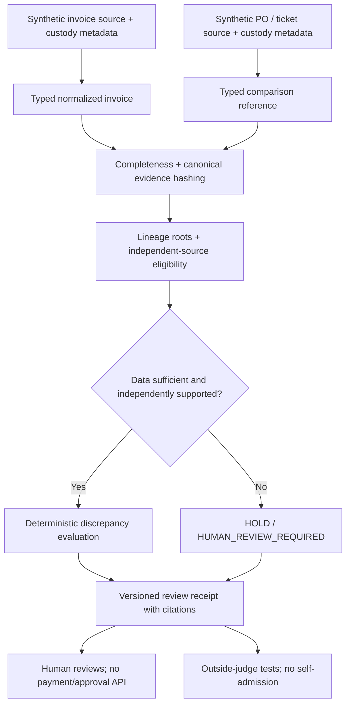

# KUSANAGI OMEGA — Proof-Gated Financial Review Pilot

**Status:** DESIGN FOR OWNER REVIEW; NOT IMPLEMENTED; PRODUCTION HOLD  
**Date:** 2026-10-17  
**Canonical repository:** `victormart43210-ship-it/Valexii-Aurex`  
**Selection:** Hypothesis C, explicitly selected by owner: narrow human-reviewed financial discrepancy checking before any generalized evidence platform.  
**Authority:** Evidence → Qualification → Reality → Authority → Effect. The system may never be its own sole witness.

## 1. Goal and success boundary

Build a **deterministic, offline, no-paid-inference pilot** that accepts one **synthetic** invoice and zero or more **synthetic** purchase-order or field-ticket records, identifies material disagreements, and produces a tamper-evident **review receipt** with complete referenced source provenance. A human—not the code or any AI model—must make the business decision. Demonstrate that the proof gate catches at least the known seven adversarial extractor failures and refuses to promote missing/independent-but-unproven inputs.

The first milestone is a **Python library and tests** in the existing AUREX repo. No HTTP route, DB migration, Lovable edit, BCXMET permission, Railway deploy, external model, payment execution, source-document upload or real customer data. The existing deployed read-only backend is unaffected.

Success means: deterministic receipts; complete evidence-field coverage; explicit `UNKNOWN`; discrepancies with cited evidence; no false authorization from self-reported witnesses; tests that prove fail-closed behavior. Success does **not** mean verified invoice authenticity or production financial accuracy.

## 2. Why this bounded pilot

Existing canonical `main` at initial inspection: `df0654390049118a142ec3b3356f0f40b4789fe4`. `aurex/provenance.py` supplies `canonical_json` / `fingerprint`; `aurex/workflows/budget.py` defaults to $0. No `aurex/financial/invoice_fields.py` exists on canonical `main`. The historical convergence branch's `aurex/financial_extractor.py` (blob `1dd836e15ce5fbc59550fd99bd6fb054b2645510`) is a **reference only**, not an admitted implementation: targeted independent synthetic checks previously returned 1 passed / 7 failed. Its SHA-256 covers only a subset of fields, and it confuses subtotal with grand total and missing amounts with zero. The historic branch is 26 ahead / 117 behind `main`; do not merge wholesale.

Three approaches considered: improve a general invoice parser without evidence semantics (fast, weak trust); build a universal cross-product proof framework first (expensive and premature); **selected: one proof-gated review workflow** (small, measurable, reusable later). The proof protocol's uniqueness and customer value are **hypotheses**, not verified inventions or revenue.

## 3. System boundary and data flow

All records are scoped to a **single case** and supplied explicitly by the caller. No directory scans, filesystem access, implicit web requests, local USB access, or automatic document recognition. The first implementation uses **manually normalized synthetic fields** to separate the source-evidence problem from OCR/parser accuracy; a later opt-in adapter may consume reviewed parser output.

## 4. Minimal components and interfaces

Use existing project Python/Pydantic conventions and existing `aurex/provenance.py` without rewriting unrelated code. Proposed isolated module path: `aurex/financial_review/`.

1. **`models.py`** — validated, frozen Pydantic v2 types:
   - `SourceRef`: `source_id`, `kind` (INVOICE / PURCHASE_ORDER / FIELD_TICKET / CREDIT_NOTE), `sha256_original_bytes` (lowercase SHA-256 of **all original bytes**, computed by the explicit fixture builder), `custody_root` (who controlled the upstream source), `obtained_at` (timezone-aware RFC3339), `authentication_status` (UNVERIFIED / INDEPENDENTLY_VERIFIED). Different file IDs do not prove different custody roots.
   - `FieldEvidence`: `field`, canonical typed value or `None`, `source_id`, original-text span or `None`, origin `MANUAL_ENTRY` / `PARSER`, `verification_status`. Unknown is `None` plus reason; `None` cannot be coerced to zero, `USD`, a vendor identity, or today's date.
   - `InvoiceFacts`: case-local vendor ID, invoice number/date, currency, total, tax and optional item-level quantities/prices, each bound to `FieldEvidence`. Money **Decimal**, finite, exact 2-place USD/EUR/GBP handling for v1; raw float rejected at the boundary. Dated values must parse as actual calendar dates, not regex-only substrings. Credit notes/signed negative amounts are **out of v1 scope → HOLD**.
   - `ReferenceFacts`: optional PO/ticket identifier, vendor, currency, authorized amount and item quantities; fields include source provenance.
   - `ReviewReceipt`: version, case ID, deterministic input digest(s), source IDs + custody roots + exact original byte hashes, complete canonicalized normalized values, policy/version ID, discrepancy objects and cited field/source refs, unresolved/missing items, evidence-valid-at timestamp **provided by caller**, findings status, human-review flag, canonical receipt SHA256. Never include raw invoice text, secrets, bearer tokens or customer files.

2. **`canonicalize.py`** — explicit domain-separated versioned receipt hashing: `SHA256("AUREX-FIN-REVIEW\x00v1\x00" || canonical_json(receipt_without_digest))`. For stable results canonicalize Decimal to fixed-scale strings, ISO timestamps UTC, and lists sorted only where order is semantically irrelevant. Hash the entire normalized evidence record, *all* defined fields, independent lineage claims and policy metadata. Keep original-source-byte hashes distinct from derived-record hashes. A SHA verifies **integrity**, never source authenticity.
3. **`compare.py`** — deterministic exact comparisons for vendor ID, currency, grand total, relevant quantities and invoice ID reuse (only if a separate provided context record exists). No fuzzy matching or automatic financial advice. Differences become `DISCREPANCY` with expected/observed and source citations; absent/invalid/contradictory values become `UNKNOWN` with reason; no autofilled values.
4. **`gate.py`** — pure, side-effect-free `review_case(case, *, evaluation_time, policy_version="pilot-v1") -> ReviewReceipt`. Default `HOLD` / `HUMAN_REVIEW_REQUIRED` when a required field or valid reference is missing. Distinct evidence requires different verified custody roots, not two model outputs or duplicate data under different file IDs. Initial model may present `NO_DISCREPANCY_DETECTED` only when the required comparisons were performed; **never** `APPROVED`, `AUTHORIZATION_GRANTED` or payment allowed. Unverified custody must always keep the claim provisional. Receipts are advisory **only**.
5. **`tests/test_financial_review_*.py`** — synthetic fixtures and deterministic property/adversarial cases, no real customer data or network.

**Schema clarity:** v1 required comparisons: invoice vendor ID, invoice number, valid invoice date, grand total, currency, and one independently sourced PO/ticket reference with vendor ID, currency and authorized total. Tax/item lines are optional but must be represented and hashed if present. Without the comparison reference (or without authenticated independent custody): `HOLD`. A mismatch is `DISCREPANCY` **and** `HUMAN_REVIEW_REQUIRED`; a match is `NO_DISCREPANCY_DETECTED` **and** `HUMAN_REVIEW_REQUIRED`. Neither status authorizes money movement.

## 5. Security and correctness invariants

- **One-cause/one-witness rule:** multiple artifacts derived from the same upstream `custody_root` count as **one** source. Claims of independent verification are supplied only by a separately trusted human/custody adapter in a later phase; a caller-provided string does not prove authenticity. For v1, source independence is a **reported condition**, not admitted external attestation. Accordingly the resulting financial decision ALWAYS needs human review.
- **No-self-witness:** a parser, model, invoice sender or `review_case()` cannot promote its own output to authorized financial effect. Status is descriptive, not an authority grant.
- **Tamper evidence:** mutations of invoice date, tax, invoice total, vendor, currency, any item, source-byte hash, source lineage, policy or verification status MUST change the normalized receipt digest. Digest comparisons must be against independently obtained expected digests to detect actual substitution.
- **Fail-closed:** missing `total` ≠ zero; no date inferred from a different field; no subtotal used as grand total; inconsistent currencies/credit notes/out-of-range values → HOLD or DISCREPANCY with clear reason.
- **Time and revocation:** the pilot records caller-supplied evaluation time and verification state but does **not** yet provide a production revocation service or reusable authorization capability. Future authority checks must re-evaluate dependencies and invalidate on revocation before effect.
- **Privacy:** only synthetic data committed. Future real-data pilot must be separately authorized, remain local/private, and redact test logs. Never move documents from THE BIG ONE USB into ChatGPT/GitHub/Lovable/Railway without separate explicit permission.
- **Cost:** no paid inference, internet calls, filesystem scans, or automatic jobs; budget default remains $0.
- **Execution:** no POST/job/payment/wallet transfer endpoint, no automation of invoice approval or financial effect.

## 6. Adversarial tests and outside judge

Tests are written **RED before GREEN** in a new exact-main branch. Assert real behavior, not mocked output. Mandatory synthetic cases:

1. `Invoice Number: INV-12345` resolves to `INV-12345`, not `Number`, **only if** a separately scoped parser adapter is built later. Pilot typed inputs avoid parsing.
2. `INVOICE NO. ABC-100` resolves correctly in that optional adapter; no `NO` false positive.
3. Grand total never taken from `Subtotal`; conflicting/subtotal-only raw documents need review.
4. Missing total stays `None`, never `0.00`.
5–7. Date, tax and line item edits each change digest.
8. Same input + same explicit evaluation time/policy → byte-identical receipt and digest.
9. Different raw file SHA or source identity → different digest even if numeric fields match.
10. Two sources with same custody root do **not** satisfy independent verification.
11. Two sources with different **claimed** roots but no trusted attestation are NOT independently proven; remain provisional.
12. Absent/invalid dates, different currencies, contradictory totals, negative credits, nonfinite/float amounts → fail closed.
13. Modified or expired verification-state fixtures → HOLD; no stale approval.
14. No source bytes, secret tokens or private documents enter serialized receipts or logs.
15. Receipt never contains any action authorization, `ADMIT` or API call.

For the **research claim** (not required for the initial software pilot), compare gate vs a plain invoice-extraction + human-review baseline using a consented, independently labeled real-document holdout. Measure critical-field precision, recall, discrepancy precision, abstention, review time per invoice, error severity, and operator cost. Prefer a blinded independent reviewer. Initial feasibility may begin with a small fully synthetic corpus; a real 100+ document feasibility sample and 1,000+ document independent holdout are later, separate opt-in stages. 0 failures in 1,000 does not establish a zero failure rate; report confidence intervals and label provenance. Demonstrated customer willingness to pay is a distinct commercial gate.

## 7. Work boundaries and staged acceptance

**Stage 1 (after owner-approved spec+implementation plan):** frozen models, complete canonical receipts, pure review gate, targeted RED/GREEN tests on an isolated main-derived branch. Draft PR only. Reviewer checks changed files and all tests; CI exact commit must execute, not merely display a badge.

**Stage 2 (separate authorization):** optional adapter around the original invoice extractor recovered from the owner's local source, with tests against the known seven failures; original source must be inspected, not recreated silently.

**Stage 3 (separate authorization and consent):** local-only, independently labeled, privacy-preserving real-invoice pilot; compare against a simpler baseline, measure false positives, avoided review time, and customer value.

**Stage 4 (future and separately approved):** expose a read-only AUREX/OX evidence view with owner-only authentication only after end-to-end bridge tests and real website repo access. Real payment, automatic approval or BCXMET authority integration remain outside this project.

### Definition of done for Stage 1

- All fixture and adversarial tests pass **on exact PR head**, with captured commands and status.
- No raw float accepted for financial values, no unsupported source claims, no false zero total.
- Complete receipt/source digest mutation tests pass; reported inputs remain synthetic.
- No `ADMIT` / executable financial permission; public/owner API routes and Railway service unchanged.
- Dependency/license review and independent human code review completed; relevant Ruff, Mypy strict and pytest checks actually executed with failures documented.
- Draft PR and explicit **HOLD** until owner reviews and later authorizes any merge/deploy.

## 8. Known uncertainty, ownership and rollback

Real financial source quality, independence attestation availability, patent novelty, precision and customer demand are **NOT VERIFIED**. Source claims and field values are not trusted simply because they are hashed. No proof of production live AUREX/OX/BCXMET integration is implied.

Scoped owner: new `aurex/financial_review/` modules + new tests only; no database schema, unrelated `aurex/api.py`, Lovable UI or BCXMET files in Stage 1. Rollback: discard scoped development branch/draft PR; `main` and production remain unchanged. Any later release requires separate owner approval.

**Owner design-review question:** Approve this **offline, synthetic-first, advisory-only Stage 1** as the implementation target, or request changes before any product code is written.
